<div align="center">

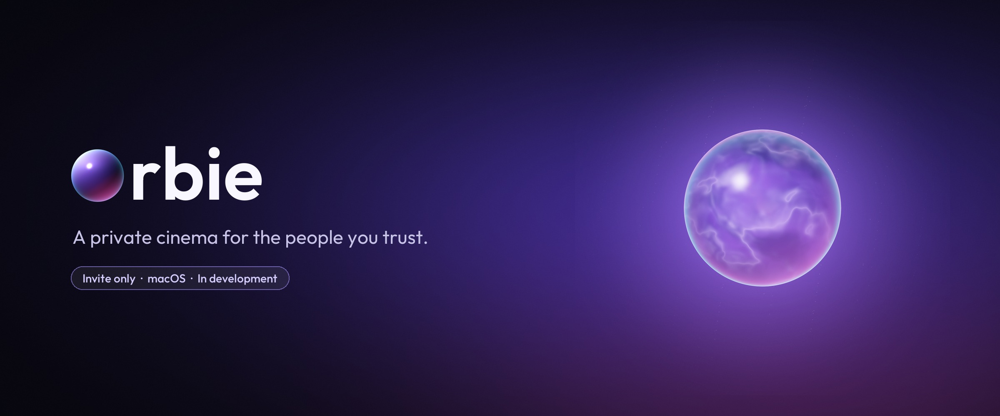

<br>

**Every film and series, one click away. Picked for you, played in 4K, watched together.**

<br>

<a href="https://github.com/Manteh/orbie-app/releases/latest"><b>Download for Mac</b></a>&nbsp;&nbsp;·&nbsp;&nbsp;<a href="#getting-in">How to get in</a>&nbsp;&nbsp;·&nbsp;&nbsp;<a href="#questions">Questions</a>

<sub>macOS 15+ on Apple Silicon&nbsp;&nbsp;·&nbsp;&nbsp;Invite only&nbsp;&nbsp;·&nbsp;&nbsp;In active development</sub>

</div>

<br>

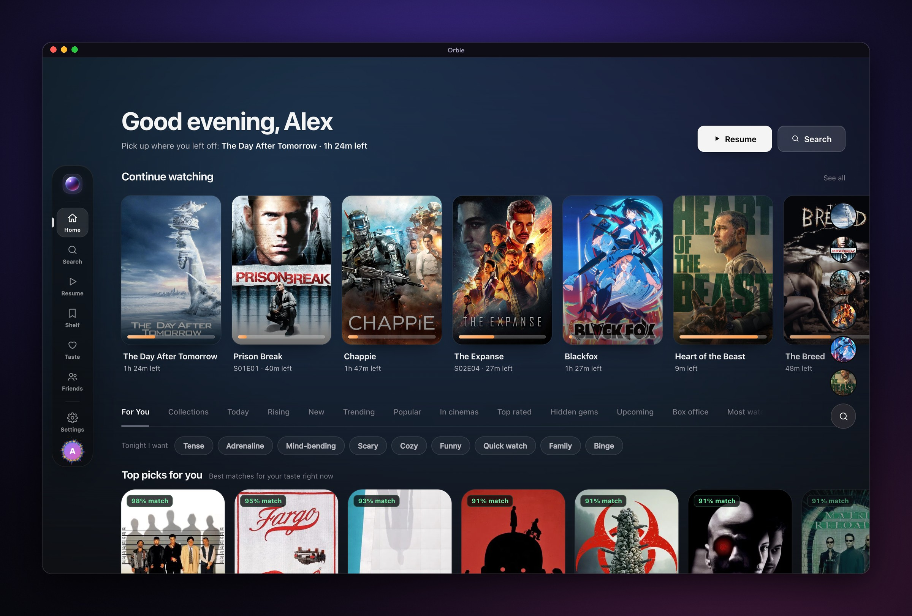

<br>

## A cinema that lives on your Mac

Open Orbie and it already knows what you were watching, what you would love next and which version of a film will look
and sound best on your screen. Press **Play** and it starts in the app window, in seconds. No ads, no rows of things you
will never watch, no account with us: everything Orbie learns about your taste stays on your own Mac.

<table>
<tr>
<td width="33%" valign="top">

### Picks that know you
Every rating and every series you binge shapes **For You**. Each pick says why, with a match score built from your own taste.

</td>
<td width="33%" valign="top">

### The best version, instantly
4K, Dolby Vision, Atmos, your language. Orbie picks the right copy and starts it straight away. Curious? Every option is explained.

</td>
<td width="33%" valign="top">

### Made for the Mac
A native app: hardware decoding, 120 Hz motion, media keys, Picture in Picture, a menu bar remote and *Watching* on Discord.

</td>
</tr>
</table>

<br>

## A closer look

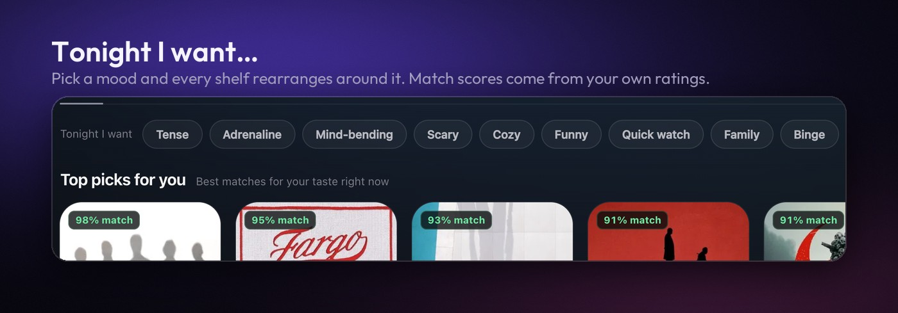

<table>
<tr>
<td width="50%">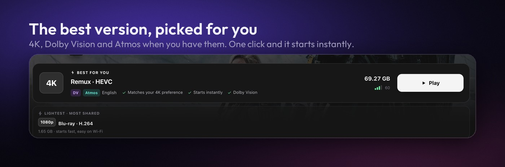</td>
<td width="50%">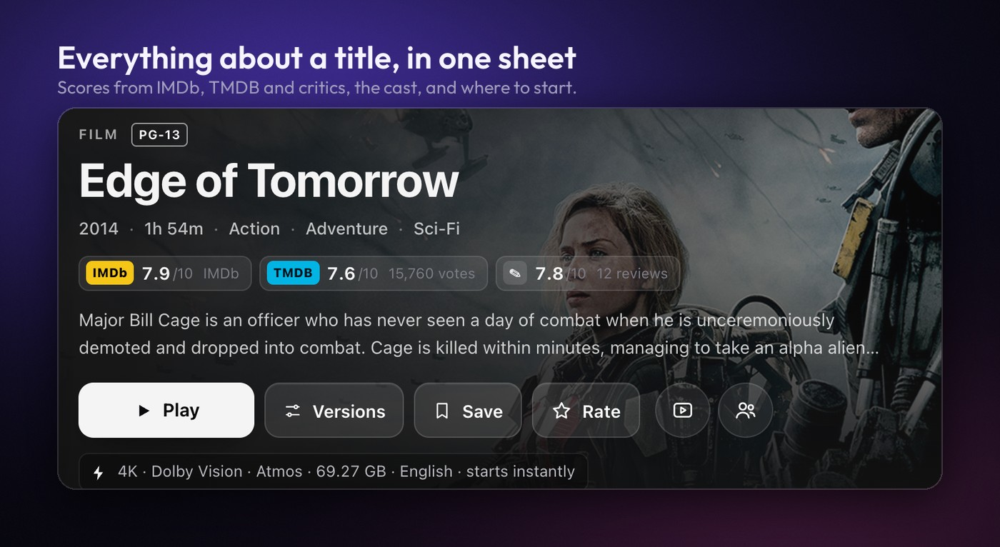</td>
</tr>
<tr>
<td width="50%">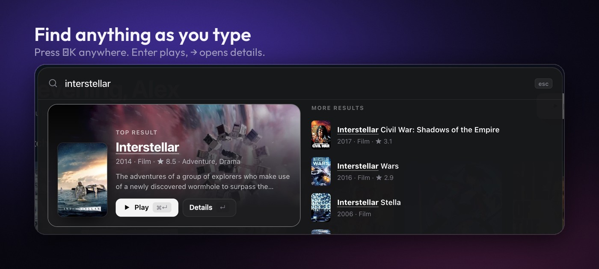</td>
<td width="50%">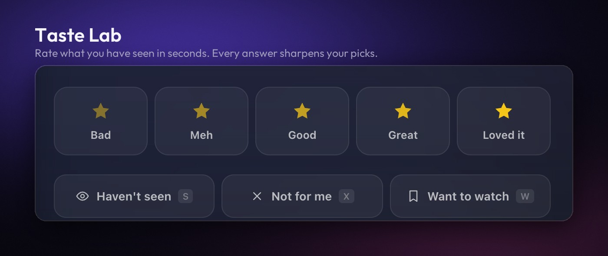</td>
</tr>
</table>

<br>

## Every title, one sheet

Scores from IMDb, TMDB and critics, the story, the cast, trailers and reviews. For series, every season and episode,
with what you have seen ticked off.

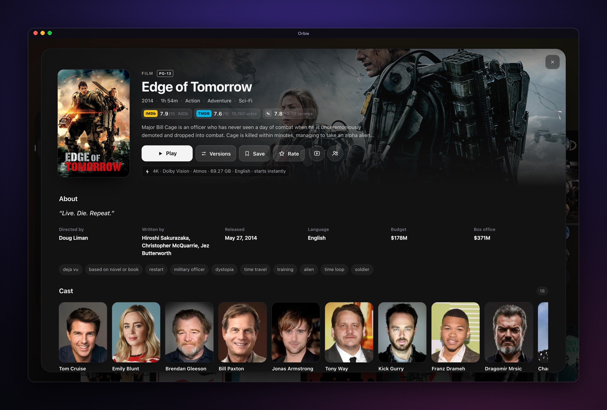

## Choose a version, not a file

Every copy of a film, duplicates merged and ranked for **you**: picture, sound, language, size and how fast it starts.
The top one plays with one click. Something lighter for Wi-Fi, or another language, is one row down.

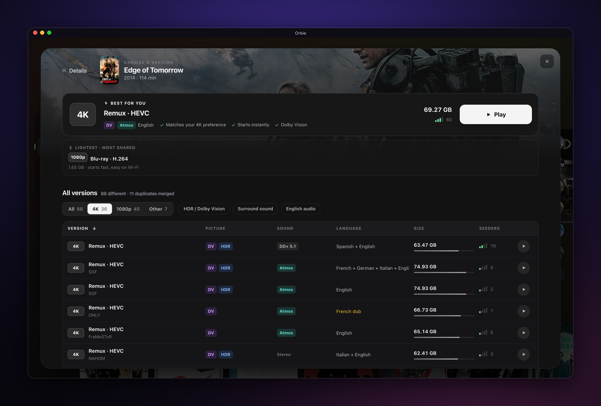

## Shelves for every mood

More than eighty hand-made collections, from edge-of-your-seat thrillers and mind-benders to films and series **by
country**, and seasonal shelves that appear at the right time of year.

<table>
<tr>
<td width="50%">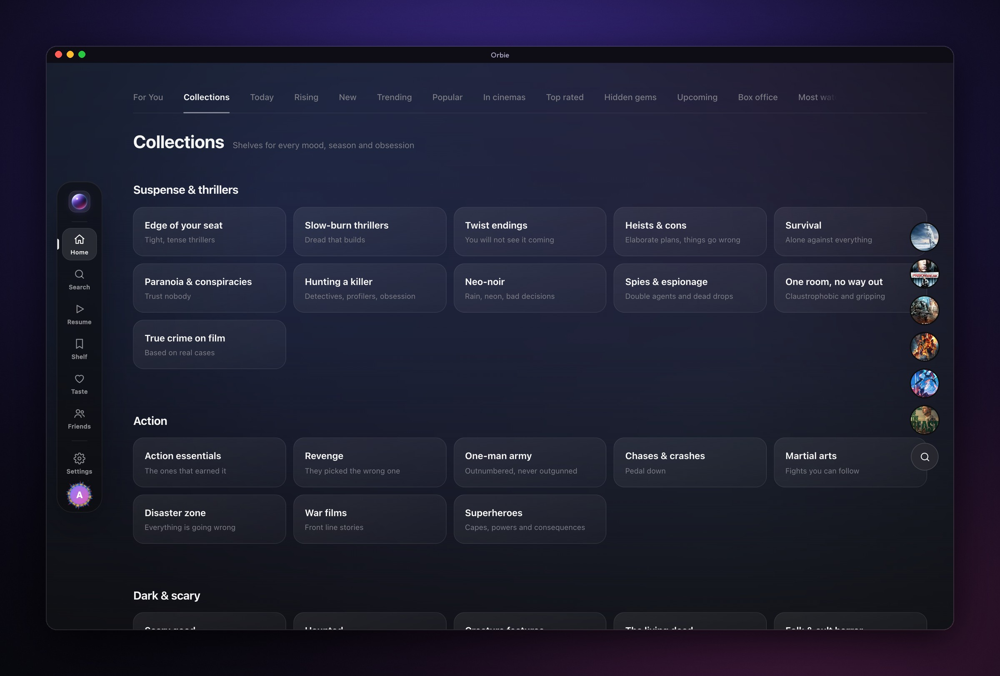</td>
<td width="50%">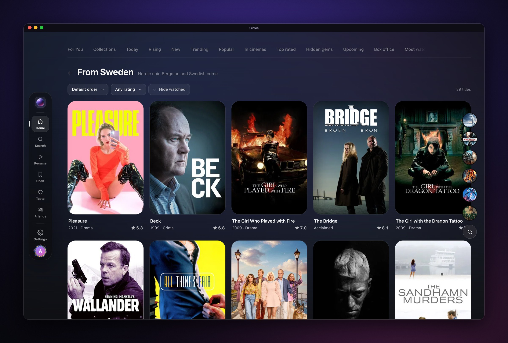</td>
</tr>
</table>

## Find anything as you type

Press <kbd>⌘</kbd> <kbd>K</kbd> anywhere. <kbd>Enter</kbd> plays, <kbd>→</kbd> opens the details.

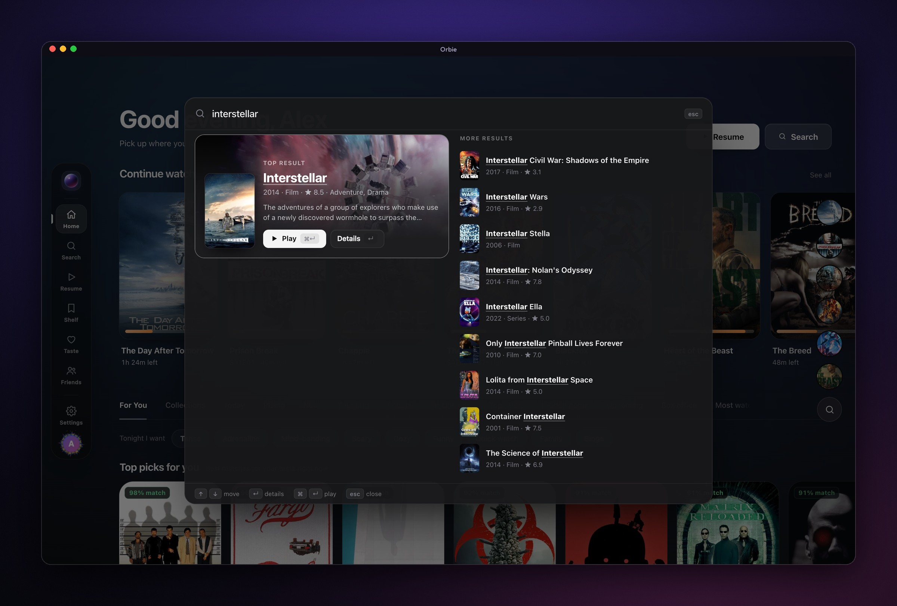

## It gets to know you

**Taste Lab** turns rating into a game, and your **profile** keeps the story of your year in film.

<table>
<tr>
<td width="50%">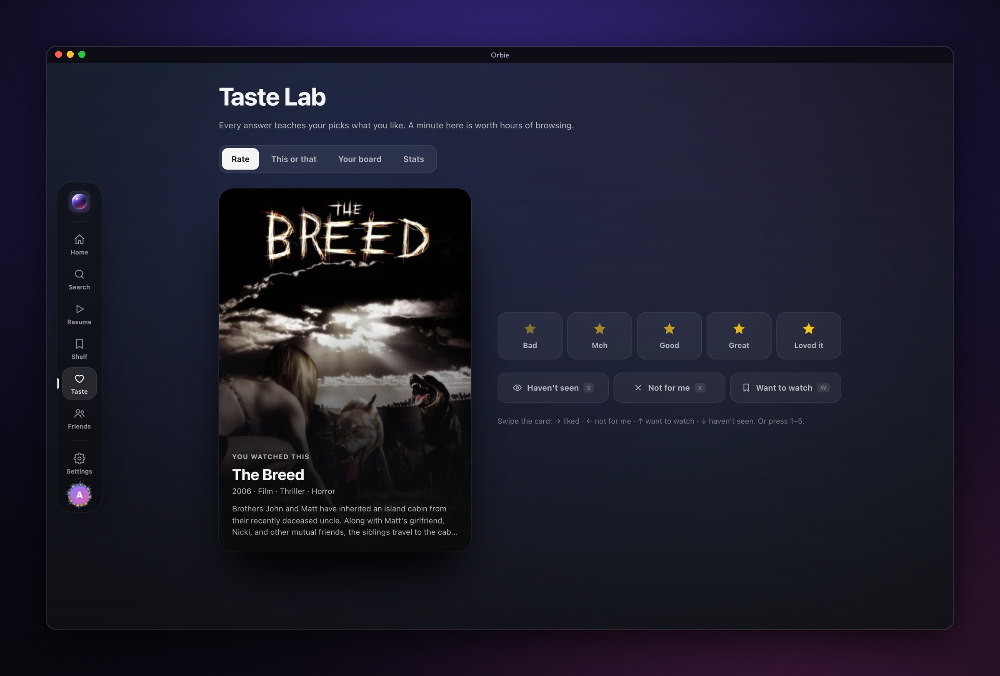</td>
<td width="50%">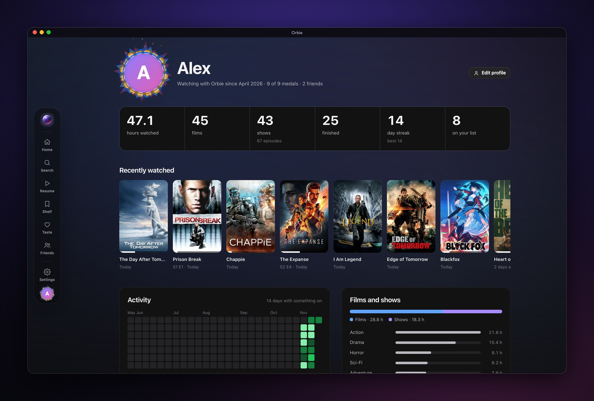</td>
</tr>
</table>

## Watch together

Press play together with friends, in sync to a fraction of a second, with a countdown, chat and live reactions. Everyone
streams on their own Mac; only small messages pass between you. **No video is ever shared.**

<br>

## Getting in

Orbie is **invite only**. Anyone can download it, but it only opens with an invite from a member.

**1. Install.** Paste this into Terminal. It downloads the latest version, puts Orbie in Applications and opens it.
Run it again any time to update (Orbie also tells you when there is a new version).

```bash
curl -fsSL https://raw.githubusercontent.com/Manteh/orbie-app/HEAD/install.sh | bash
```

Or download the zip from [**Releases**](https://github.com/Manteh/orbie-app/releases/latest), unzip it and drag
**Orbie** into Applications.

**2. Paste your invite.** It looks like `orbie-…` and it can sit inside a whole message; Orbie finds it.

**3. Say who you are.** *Continue with Discord* brings your name and picture, or pick them yourself.

**4. Connect a debrid account.** TorBox is recommended. It is what makes every stream start instantly. Use your **own**.

That's it. Each member can pass on three invites from **Settings → Invites**.

<br>

## Questions

<details>
<summary><b>Why invite only?</b></summary>
<br>
Orbie is built for friends, and grows the way friendships do. Every invite carries the name of the person who sent it,
so the circle stays people someone vouches for.
</details>

<details>
<summary><b>What is a debrid account, and do I need one?</b></summary>
<br>
A debrid service (TorBox, Real-Debrid or AllDebrid) keeps files ready on fast servers so playback starts instantly. Orbie
needs one to play anything. Each person should use their own; sharing one breaks most providers' terms.
</details>

<details>
<summary><b>What does Orbie know about me?</b></summary>
<br>
Only what you do in it, and all of it stays on your Mac: your history, ratings, taste and keys. There is no Orbie account
and no Orbie server that stores anything about you. <i>Continue with Discord</i> only reads your public name and picture.
</details>

<details>
<summary><b>Windows? iPhone?</b></summary>
<br>
Mac only for now (macOS 15 Sequoia or later, Apple Silicon). Orbie is in active development; things change quickly.
</details>

<details>
<summary><b>macOS says the app can't be opened</b></summary>
<br>
Use the Terminal line above: it installs Orbie in a way macOS accepts. If you dragged it in by hand, right-click
<b>Orbie</b> in Applications and choose <b>Open</b> once.
</details>

<br>

## Notes

Orbie is a player and a lookup tool. It doesn't host or index any content. You are responsible for what you stream and
for following the terms of the services you connect and the laws where you live.

<div align="center"><br><br><sub>Made with care on a Mac.</sub></div>
